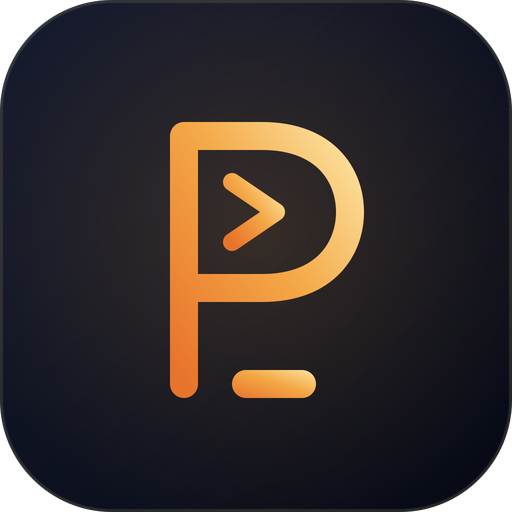

  

<h1 align="center">Phoenicx SSH</h1>

  A lightweight, tabbed SSH client for <b>Windows</b> and <b>Android</b> with a live server monitor and file transfer. 
  Built for Oracle Cloud instances, and it works with any Linux server.

  <a href="https://github.com/hansonds/Phoenicx-SSH/releases/latest/download/PhoenicxSSH-Windows-Setup.exe"><b>⬇ Windows installer (.exe)</b></a> ·
  <a href="https://github.com/hansonds/Phoenicx-SSH/releases/latest/download/PhoenicxSSH-Windows-Portable.zip"><b>⬇ Windows portable (.zip)</b></a> ·
  <a href="https://github.com/hansonds/Phoenicx-SSH/releases/latest/download/PhoenicxSSH-Android-arm64.apk"><b>⬇ Android (.apk)</b></a>

---

## Download

These links always give you the newest version.

| Device | Download | How to install |
|---|---|---|
| **Windows 10/11 (recommended)** | [PhoenicxSSH-Windows-Setup.exe](https://github.com/hansonds/Phoenicx-SSH/releases/latest/download/PhoenicxSSH-Windows-Setup.exe) | Run it. It adds Phoenicx SSH to the Start menu (and the desktop if you tick the box). No admin rights needed. |
| Windows, no install | [PhoenicxSSH-Windows-Portable.zip](https://github.com/hansonds/Phoenicx-SSH/releases/latest/download/PhoenicxSSH-Windows-Portable.zip) | Unzip it anywhere (even a USB stick) and run `PhoenicxSSH.exe`. |
| **Android phone (Samsung etc.)** | [PhoenicxSSH-Android-arm64.apk](https://github.com/hansonds/Phoenicx-SSH/releases/latest/download/PhoenicxSSH-Android-arm64.apk) | Open the file and allow "Install unknown apps" when asked. |
| Any Android (if unsure) | [PhoenicxSSH-Android-universal.apk](https://github.com/hansonds/Phoenicx-SSH/releases/latest/download/PhoenicxSSH-Android-universal.apk) | Bigger, but works on every Android device. |

Older versions and release notes: [all releases](https://github.com/hansonds/Phoenicx-SSH/releases).

If Windows SmartScreen says "Windows protected your PC", click **More info → Run anyway**. The app isn't code-signed yet.

> The Google Play version and the APKs here are signed differently, so Android won't install one over the other. Export your connections first (Servers → Export), uninstall, install the other one, then import.

## Features

- **Sessions that stay connected.** A session ends only when you close it. If Wi-Fi drops, you switch to mobile data or the server reboots, the tab reconnects by itself and keeps your scrollback.
  - Keep-alive checks catch "dead" connections within seconds.
  - On Android, a small foreground service keeps sessions running with the screen off or the app in the background.
  - Optional **tmux mode**: programs keep running on the server, and the app re-attaches to the same screen after a reconnect.
- **File transfer (SFTP).** Tap **Files** in any session to browse the server's folders.
  - **Upload** files from your PC or phone (several at once), or a **whole folder** with all its sub-folders. **Download** files, or a whole folder as a `.tar.gz`.
  - Downloads go to your **Downloads** folder (on Android: `Download/Phoenicx SSH`).
  - Progress bar with speed, cancel button, and transfers keep running when you close the panel.
  - **Edit** small text files (configs, `docker-compose.yml`, `Caddyfile`…) right in the app and save them back.
  - Rename, delete, new folder, **permissions (chmod)**, show hidden files, copy path or paste it into the terminal.
  - Uses the same login as the terminal, so nothing has to be installed on the server.
- **Live server monitor** with graphs for CPU (including Oracle "steal" time), memory, network and disk.
  - Top processes by CPU or RAM, grouped by app or listed one by one. You can end a process from the list.
  - **Docker containers**: CPU, RAM, network and disk I/O per container.
  - **Network per app**, using `nethogs` (the app can install, upgrade or remove it for you).
- **Commands button.** Paste common Linux commands with one tap. Add your own, edit them and drag to reorder.
- **Tabs.** Open several servers at once, or the same server more than once.
- **Backup.** Export all connections and commands, including keys, to one file encrypted with AES-256 and a password of your choice. Import it on another PC or phone.
- **Import from PuTTY** (Windows): brings over your saved PuTTY sessions and their `.ppk` keys in one click.
- **Every common key format.** It reads Oracle `.key` (PKCS#8), OpenSSH, `.pem`, and PuTTY `.ppk` files (RSA, Ed25519 and ECDSA).
- **Light on the server.** Monitoring runs as one small shell loop that reads `/proc`, with no agent to install. Process and Docker stats are collected only while the monitor panel is open.
- Touch keys on Android (Esc, Tab, Ctrl, Alt, arrows and more). On Windows, right-click copies and pastes like PuTTY.
- Logins are stored encrypted on the device: AES-256-GCM, with the key kept in the Android Keystore or Windows DPAPI.
- No account, no ads, no tracking. See the [privacy policy](PRIVACY.md).

## Connect to an Oracle Cloud instance

1. Tap **New host**.
2. Fill in the details:
   - **Host:** the instance's public IP.
   - **Username:** `ubuntu` for Ubuntu images, `opc` for Oracle Linux.
   - **Login with:** Private key. Load the `.key` file Oracle gave you when you created the instance, or your `.ppk`.
3. Tap **Save & connect**.

## Copy files to and from the server

1. Connect to the server.
2. Tap **Files** in the toolbar (folder icon on phones).
3. To send files to the server, open the folder you want and tap **Upload**, then choose **Upload files** or **Upload a folder**. A folder is copied with everything inside it; if it already exists on the server, files with the same name are replaced and the rest are kept.
4. To get a file, tap its ⬇ button. For a folder, tap ⋮ → **Download as .tar.gz**.
5. Right-click (Windows) or long-press (Android) any item for rename, edit, permissions and delete.

## Credits

Made by **Hanson** · [phoenicx.org](https://phoenicx.org)

Built with Flutter, [dartssh2](https://pub.dev/packages/dartssh2) and [xterm.dart](https://github.com/TerminalStudio/xterm.dart).
