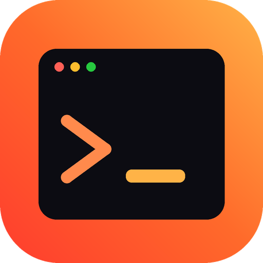

  

<h1 align="center">Phoenicx SSH</h1>

  A lightweight, tabbed SSH client for <b>Windows</b> and <b>Android</b> with a live server monitor. 
  Built for Oracle Cloud instances, and it works with any Linux server.

---

## Features

- **Sessions that stay connected.** A session ends only when you close it. If Wi-Fi drops, you switch to mobile data or the server reboots, the tab reconnects by itself and keeps your scrollback.
  - Keep-alive checks catch "dead" connections within seconds.
  - On Android, a small foreground service keeps sessions running with the screen off or the app in the background.
  - Optional **tmux mode**: programs keep running on the server, and the app re-attaches to the same screen after a reconnect.
- **Live server monitor** with graphs for CPU (including Oracle "steal" time), memory, network and disk.
  - Top processes by CPU or RAM, grouped by app or listed one by one. You can end a process from the list.
  - **Docker containers**: CPU, RAM, network and disk I/O per container.
  - **Network per app**, using `nethogs` (the app can install it for you).
- **Tabs.** Open several servers at once, or the same server more than once.
- **Backup.** Export all connections, including keys, to one file encrypted with AES-256 and a password of your choice. Import it on another PC or phone.
- **Import from PuTTY** (Windows): brings over your saved PuTTY sessions and their `.ppk` keys in one click.
- **Every common key format.** It reads Oracle `.key` (PKCS#8), OpenSSH, `.pem`, and PuTTY `.ppk` files (RSA, Ed25519 and ECDSA).
- **Light on the server.** Monitoring runs as one small shell loop that reads `/proc`, with no agent to install. Process and Docker stats are collected only while the monitor panel is open.
- Touch keys on Android (Esc, Tab, Ctrl, Alt, arrows and more). On Windows, right-click copies and pastes like PuTTY.
- Logins are stored encrypted on the device: AES-256-GCM, with the key kept in the Android Keystore or Windows DPAPI.

## Download

Open [Releases](../../releases) and pick a file:

| Device | File |
|---|---|
| Android phone (Samsung etc.) | `PhoenicxSSH-x.y.z-arm64.apk` |
| Any Android (if unsure) | `PhoenicxSSH-x.y.z-universal.apk` |
| Windows 10/11 | `PhoenicxSSH-x.y.z-Windows-x64-portable.zip`: unzip it and run `PhoenicxSSH.exe` |

## Connect to an Oracle Cloud instance

1. Tap **New host**.
2. Fill in the details:
   - **Host:** the instance's public IP.
   - **Username:** `ubuntu` for Ubuntu images, `opc` for Oracle Linux.
   - **Login with:** Private key. Load the `.key` file Oracle gave you when you created the instance, or your `.ppk`.
3. Tap **Save & connect**.

## Building

GitHub Actions builds everything (see `.github/workflows/build.yml`).

- Every push to `main` builds Android and Windows.
- Running the workflow manually with a version number, or pushing a `v*` tag, also publishes a Release.

To sign the APK with your own key, add these repository secrets: `ANDROID_KEYSTORE_BASE64`, `ANDROID_KEYSTORE_PASSWORD` and `ANDROID_KEY_ALIAS`.

## Credits

Made by **Hanson** · [phoenicx.org](https://phoenicx.org)

Built with Flutter, [dartssh2](https://pub.dev/packages/dartssh2) and [xterm.dart](https://github.com/TerminalStudio/xterm.dart).
